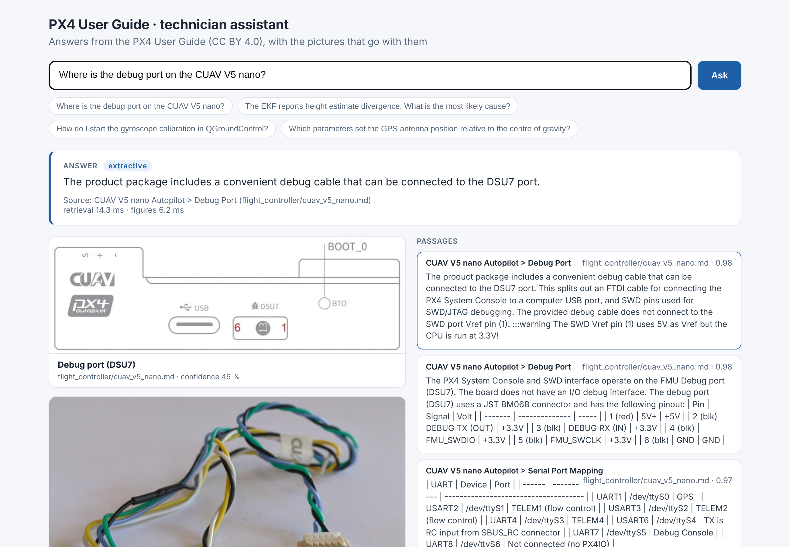
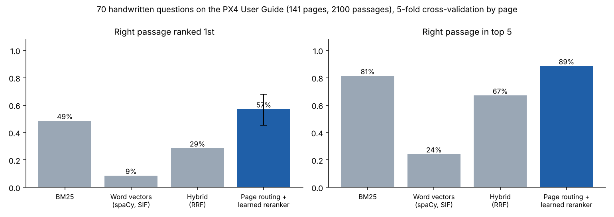

# Documentation assistant for technicians: answers and pictures from a real equipment guide

[](https://github.com/kawtar-bellamine/maintenance-doc-rag/actions/workflows/tests.yml)

A technician asks a question in plain words (*where is the debug port on the CUAV V5 nano?*, *the EKF reports height
divergence, what is the cause?*). The assistant finds the right passage of the documentation, quotes the answer with
its source, and shows the picture that goes with it (a pinout, a wiring diagram, a calibration screen) only when it
is confident the picture is the right one.

**Corpus: the real [PX4 Autopilot User Guide](https://github.com/PX4/PX4-user_guide)** (Dronecode Foundation,
CC BY 4.0), pinned to commit `2fa62338` (April 2026): 141 pages on assembly, wiring, flight controllers, configuration,
calibration and advanced settings, 124,000 words, 446 images. The generated parameter reference (49,000 lines of
tables) is left out. Nothing is simulated: the questions were written by hand while reading the guide.



## How it works

- **Ingestion** ([`docrag/ingest_md.py`](docrag/ingest_md.py)): one heading = one passage (long tables and lists split
  at 120 words on line boundaries), and each passage keeps its context, *"CUAV V5 nano Autopilot > Debug Port"*.
  Images come from the Markdown and HTML tags: their caption is the alt text, the text inside them is read by OCR
  (Tesseract, 400 of 446 images), and they are linked to the passage that shows them.
- **Retrieval** ([`docrag/retrieval.py`](docrag/retrieval.py)): BM25 (parameter names such as `EKF2_GPS_POS_X` are
  also searchable as *gps pos*), word-vector embeddings (spaCy, SIF), **page routing** (the guide is organised by
  product: the best chunks of the three pages whose title matches the question join the candidates), then a
  **learned reranker** (logistic regression on 19 features: lexical and vector scores, page-title match, question
  intent such as *parameter*, *build*, *port*, *fault*).
- **Pictures**: a second model scores each image from the passages that show it, its caption and OCR text, and the
  question intent; an image is shown only above a threshold learned on the training pages.
- **Answer**: the sentence of the retrieved passages that best matches the question, with its page. An
  OpenAI-compatible model (Azure OpenAI or other: `LLM_BASE_URL`, `LLM_API_KEY`, `LLM_MODEL`) can write the answer
  from the same passages instead.
- **Interface**: FastAPI and React; answer, source, pictures with their confidence, passages.

## Evaluation

70 questions written by hand, each with the page that answers it, a short string the right passage must contain,
and, for 18 of them, the picture a technician needs ([`data/questions_px4.yaml`](data/questions_px4.yaml)): 22 on
specifications, 17 procedures, 11 parameters, 9 wiring, 6 pictures, 5 faults. **5-fold cross-validation grouped by
page**: the models are always tested on pages they never saw, and every question is tested once. 95% intervals
(Wilson) are given because 70 questions is a small set.

| Retrieval | Right passage 1st | Right passage in top 5 | MRR@10 |
|---|---|---|---|
| BM25 | 49% | 81% | 0.63 |
| Word vectors (spaCy, SIF) | 9% | 24% | 0.16 |
| Hybrid (reciprocal rank fusion) | 29% | 67% | 0.46 |
| **Page routing + learned reranker** | **57%** [46 to 68] | **89%** | **0.69** |

With four other fold assignments, the reranker ranks the right passage first 60% to 63% of the time.

| Pictures (18 questions need one) | Precision of the pictures shown | Right picture shown | Pictures per answer |
|---|---|---|---|
| Pictures of the top passage | 24% | 44% | 0.47 |
| Direct search on alt text and OCR | 13% | 50% | 1.0 |
| **Learned fusion, shown if confident** | **41%** | **50%** | **0.31** |

Extractive answer: the quoted sentence contains the expected answer for 50% of the questions [39 to 61]. Latency on
a laptop CPU: 7 ms for the text, 11 ms with the pictures (median).



## Findings

1. **Real documentation is harder than a synthetic manual, and that is the point.** On a manual generated for the
   first version of this project, the reranker ranked the right passage first 76% of the time; on the PX4 guide,
   57%. The guide has dozens of near-identical pages (Pixhawk 4 and Pixhawk 4 Mini, Cube Orange and Cube Orange+,
   Pixhawk 6X and 6X Pro) with the same headings and the same port names.

2. **Half the misses are on the right page.** The right page comes first for 79% of the questions; of the 30
   questions where the first passage is not the expected one, 15 are on the right page but in the wrong section
   (*"which IMU is on the Kakute H7 v2"*: the answer is the line *IMU: BMI270* in a feature list, among 15 other
   lines). Of the 15 others, about 6 point to another page that also holds the answer (the guide repeats wiring
   instructions between quick-start and product pages); the strict metric still counts them as misses.

3. **A weak dense retriever makes the hybrid worse, not better.** Without access to a neural embedding model in this
   environment, the embeddings are averaged word vectors: 9% at rank 1. Fused with BM25 by reciprocal rank, they pull
   the hybrid down from 49% to 29%. Fusion is not free: each retriever has to be measured on its own first. The
   learned reranker uses both scores as features and learns how little to trust the weak one.

4. **The page context in each passage is worth 9 points.** Without the *"Page title > Heading"* prefix, the reranker
   drops from 57% to 49% at rank 1 and the answer from 50% to 43%: a passage titled only *"Wiring"* does not say which
   flight controller it is about.

5. **Showing fewer pictures is better.** Showing every picture of the top passage gives 24% precision; the learned
   model shows a picture for one answer in three and is right 41% of the time, with the same recall. A technician
   should see the pinout he asked for, not three photos of the box.

6. **Honest caveat.** Page routing and the image threshold were added after a first evaluation on the same 70
   questions (rank-5 recall went from 83% to 89%); the figures above are therefore slightly optimistic. A second,
   untouched question set is the next step.

All numbers: [`results/metrics.json`](results/metrics.json); every question with its rank and the pictures shown:
[`results/per_question.json`](results/per_question.json).

## Run it

```bash
pip install -r requirements.txt          # also: tesseract-ocr, git
./run_all.sh                             # fetch the guide (pinned commit), index, evaluate, figures
cd web && npm install && npx vite build && cd ..
uvicorn app.api:app --port 8000          # interface on http://localhost:8000
pytest -q
```

## Limits and next steps

- A neural embedding model (e5, bge) in place of the word vectors, measured on the same questions.
- Tables: answers inside long feature lists and pin tables are the main miss; parsing Markdown tables into rows with
  their header would let the reranker see *"IMU: BMI270"* as one fact.
- A second question set, written by another person, never used to tune anything.

## Licence and attribution

Code: MIT. Corpus: *PX4 Autopilot User Guide*, © Dronecode Foundation and contributors, licensed under
[CC BY 4.0](https://creativecommons.org/licenses/by/4.0/); fetched unchanged by [`docrag/corpus.py`](docrag/corpus.py)
and not redistributed in this repository, except for the OCR text cache and the index derived from it.

Kawtar Bellamine, 2026.
